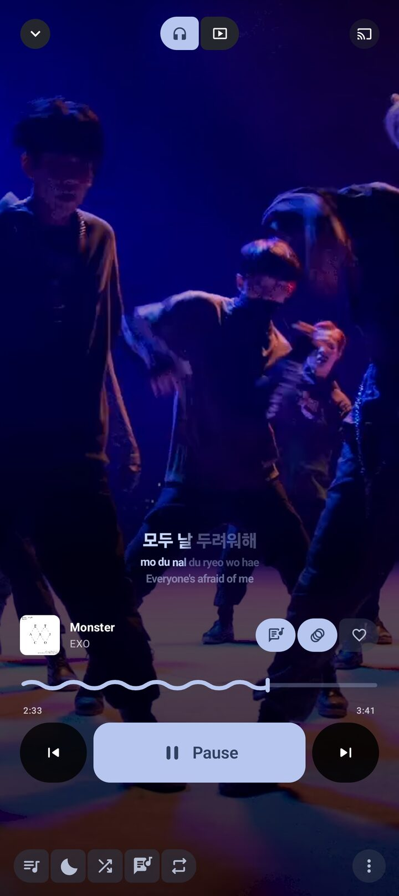
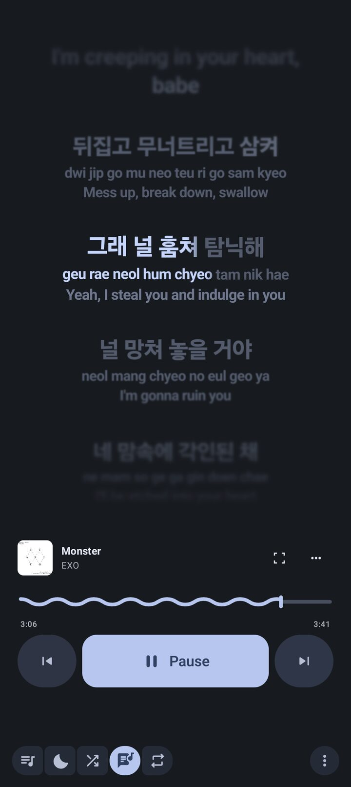
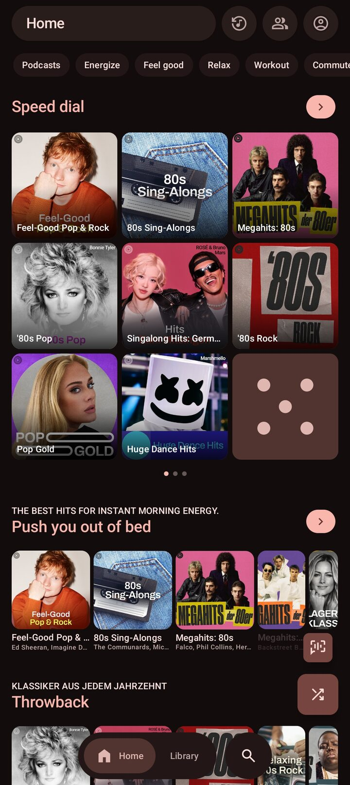
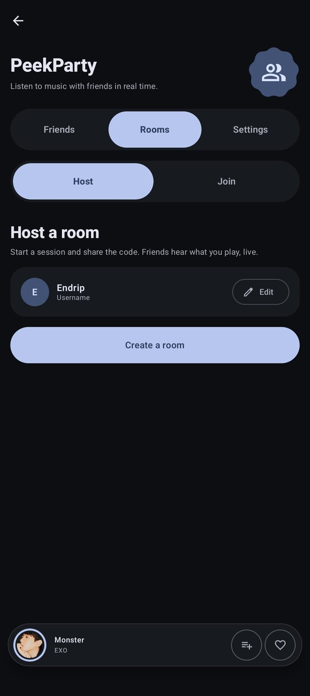

<div align="center">


# PeekMusic

### A YouTube Music client that keeps your lyrics in sight

<a href="https://github.com/PeekMusic/PeekMusic/releases/latest"></a>
<a href="LICENSE"></a>
<a href="https://crowdin.com/project/peekmusic"></a>

</div>

PeekMusic is a fork of [Metrolist](https://github.com/MetrolistGroup/Metrolist). The idea stays the same as in 1.x:
**less noise, more convenience.** Things you touch every day, like the player and the lyrics, get extra care. Settings
nobody needs stay out of the way.

> [!WARNING]
> Using a third-party client to access YouTube Music may violate YouTube's Terms of Service. You use PeekMusic at your
> own risk. YouTube Music is region-restricted; outside supported regions you need a VPN or proxy.

## PeekMusic 2.0: built on Metrolist 14

PeekMusic 2.0 starts from scratch on **Metrolist 14**, the Kotlin Multiplatform rewrite of Metrolist. One shared
codebase now runs on Android, iOS and desktop. That brings a new player, new settings, casting, statistics and many
fixes, plus faster updates from upstream from now on.

**Android comes first.** PeekMusic 2.0 ships for Android only. iOS and desktop builds follow later, once PeekMusic's
features are ready there too.

**A big thank you to the [Metrolist team](https://github.com/MetrolistGroup) and every contributor.** The rewrite is
their work, and PeekMusic would not exist without it. If you like the app, consider
[supporting Metrolist](https://github.com/MetrolistGroup/Metrolist#support-the-project).

Upgrading from PeekMusic 1.x? Install 2.0 over your current app. Your account, library, playlists, likes and history
come along, and a short onboarding shows what's new.

## Screenshots

<div align="center">






</div>

## What PeekMusic does differently

**Lyrics Peek.** The current lyric line sits between the cover and the song title, big enough to read along without
opening the lyrics. It shows word-by-word karaoke, background vocals and a ring during instrumental breaks. In landscape
it sits next to the controls.

**Lyrics that load fast.** Metrolist asks the lyrics providers one after another. PeekMusic starts the next provider
when the previous one is slow, so lyrics appear sooner without changing which source wins.

**Translation without an API key.** Translations come from Google Translate, with no account or key needed. When the
lyrics already ship with an official translation (for example from Apple Music), PeekMusic shows that one and names
the source. Songs that mix languages get every line translated, not just the main language.

**Quick switches in the player.** The share button became two buttons: **Peek** opens the lyrics menu (Peek,
translation, romanization) and **Canvas** turns the moving artwork on and off. Sharing moved to the ⋮ menu.

**PeekParty.** Listen Together with friends. Add friends by code or link, see who is online, and invite them to your
party with a notification they can accept or decline. PeekParty runs on its own server at `listen.peekmusic.org`.

**Cleaner settings.** About 40 switches are hidden and set to sensible values, and the rest are regrouped into fewer
pages. Defaults are chosen for comfort: floating bars, gradient player background, Peek on.

**Onboarding with real settings.** The first start walks through language, look, player, lyrics, canvas and sound with
live previews, so the app fits before the first song plays.

**Songs cached ahead.** PeekMusic can download the next 1 to 10 songs in the queue in advance (Wi-Fi only by default),
so skipping is instant and spotty connections don't stop the music.

**Small fixes.** Material You colors are correct on Samsung devices with preset palettes, and animated covers work on
the very first start.

Everything else is Metrolist. Discord, Last.fm and ListenBrainz are still there and stay off until you turn them on.

## Download

PeekMusic is **Android only** for now (Android 7+). iOS and desktop come later; the code is already shared.

- [Latest APK on GitHub Releases](https://github.com/PeekMusic/PeekMusic/releases/latest)
- [Add to Obtainium](https://apps.obtainium.imranr.dev/redirect?r=obtainium://add/https://github.com/PeekMusic/PeekMusic/)

The app has a built-in updater. PeekMusic installs next to Metrolist; the two don't share data.

## Translations

PeekMusic's own texts are translated on **[Crowdin](https://crowdin.com/project/peekmusic)**. If your language is
missing, request it there.

Everything else in the app comes from Metrolist and is translated on
[Metrolist's Weblate](https://hosted.weblate.org/projects/Metrolist/). Those translations reach PeekMusic with every
upstream update.

## Build

You need JDK 25. A debug build installs next to the release app:

```bash
./gradlew :androidApp:assembleDebug
```

Before a change, run `./gradlew ktlintCheck` and the tests. The developer docs from Metrolist are in
[docs/](docs/README.md).

## Thanks

- [Metrolist](https://github.com/MetrolistGroup/Metrolist) by [MetrolistGroup](https://github.com/MetrolistGroup):
  the app PeekMusic is built on.
- [InnerTubeX](https://github.com/MetrolistGroup/innertubex): YouTube streaming engine, with help from
  [ZemerTeam](https://github.com/ZemerTeam/).
- [metroserver](https://github.com/MetrolistGroup/metroserver): the Listen Together backend behind PeekParty.
- [MusicRecognizer](https://github.com/aleksey-saenko/MusicRecognizer): music recognition through Shazam.
- BetterLyrics, LrcLib, KuGou, Paxsenix and the other lyrics providers.
- Everyone who translates PeekMusic on Crowdin and Metrolist on Weblate.

## License

[GPL-3.0](LICENSE), same as Metrolist.

PeekMusic is not affiliated with, funded, authorized or endorsed by YouTube, Google LLC or their affiliates. All
trademarks belong to their respective owners.
